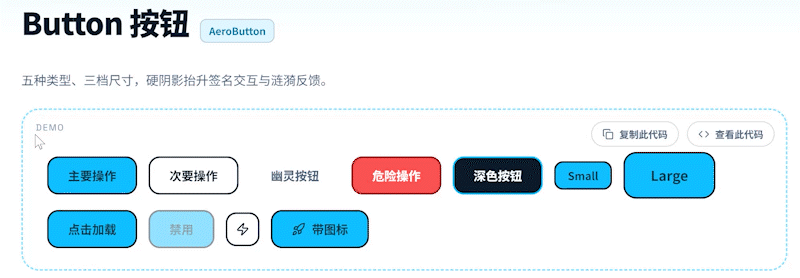

<div align="center">


English | [简体中文](https://github.com/FanXingYiDianYun/aero-ui-view/blob/main/README.zh-CN.md)

**Official demo site of the Aero UI component library** — online
preview, interactive docs and AI install guide for 102 Aero*
components

[Online Demo](https://FanXingYiDianYun.github.io/aero-ui-view/)
· [Component Library aero-vue](https://github.com/FanXingYiDianYun/aero-vue)
· [npm](https://www.npmjs.com/package/aero-vue)
</div>

---
## ✨ Component Preview



## 🚀 Quick Use

Component library version `1.0.0`. Install:

```bash
npm i aero-vue
```

```js
import 'aero-vue/styles' // same usage as the lib README (see
                         // package.json exports)
```

Per-component import example (same source as the lib README
quick-start):

```vue
<!-- App.vue -->
<script setup lang="ts">
import { AeroButton } from 'aero-vue'
</script>
<template>
  <AeroButton variant="primary">Hello, Stratosphere</AeroButton>
</template>
```

## 🧭 What the Demo Site Includes

- Online preview of 102 components (light & dark theme switching)
- AI Skill install guide (the #/ai-guide page on the demo site)
- Component search / Props / Events docs

## 🛠 Local Development

```bash
git clone https://github.com/FanXingYiDianYun/aero-ui-view
pnpm install
pnpm dev
```

## License

MIT
